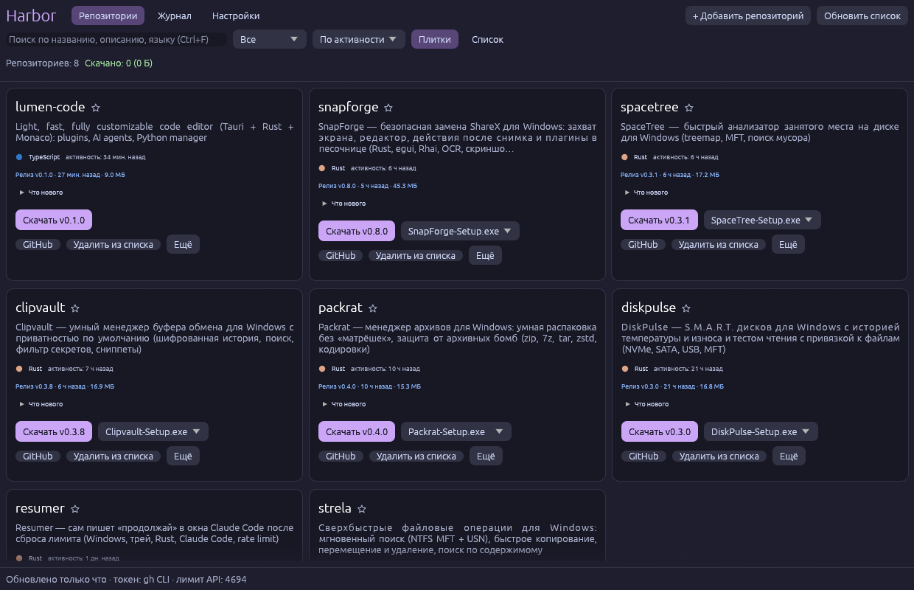

# Harbor

[English](README.en.md) · [Русский](README.md)

Все ваши проекты с GitHub в одном окне для Windows: список репозиториев подтягивается сам, программы из релизов
скачиваются, запускаются, обновляются и удаляются одной кнопкой. Как магазин приложений — только для ваших
собственных репозиториев.



*Скриншот сделан на публичных репозиториях автора; приватные в нём скрыты.*

## Возможности

- **Автоматический список.** Репозитории аккаунта и их последние релизы подтягиваются при запуске и по таймеру
  (по умолчанию каждые 10 минут, `F5` — сразу). Новые репозитории и релизы попадают в журнал. Запросы условные
  (ETag), поэтому лимит GitHub API почти не тратится.
- **Скачать.** Прогресс и отмена; если в релизе несколько файлов — выбор (по умолчанию установщик). Если в релизе
  есть `SHA256SUMS.txt`, сумма проверяется, при несовпадении файл не сохраняется. Репозитории без релизов —
  «Скачать исходники» (zip).
- **Запустить / Папка / Удалить.** «Удалить» стирает скачанное с диска (с подтверждением). **«Удалить из списка»**
  только скрывает карточку — файлы не трогает; вернуть можно фильтром «Скрытые».
- **Обновления.** Бейдж «доступно обновление», кнопки «Обновить» и «Обновить всё», по желанию — автоскачивание;
  старые версии удаляются.
- **Приватные репозитории.** Токен берётся из `gh auth token` или вводится вручную (в «Настройках»). Без токена
  работают только публичные репозитории и лимит 60 запросов в час.
- **Удобство.** Поиск (`Ctrl+F`), фильтры (с релизом, скачанные, с обновлением, избранные, приватные, скрытые),
  сортировка, плитки и список, избранное, «Что нового» из заметок релиза, добавление любого публичного
  репозитория по ссылке, журнал событий, экспорт списка в Markdown.
- **Установщик без прав администратора** и самообновление: Harbor — один из репозиториев в списке, новый релиз
  находится в той же синхронизации.

## Установка

1. Скачайте `Harbor-Setup.exe` со страницы [Releases](https://github.com/ahsoggg-creator/harbor/releases) и запустите.
   Установка идёт в `%LOCALAPPDATA%\Programs\Harbor` для вашей учётной записи, ярлык — в меню «Пуск».
2. Либо возьмите портативный `Harbor.exe` — он ничего не устанавливает.
3. В «Настройках» укажите свой GitHub-логин.

Файлы **не подписаны**: SmartScreen может предупредить («Подробнее» → «Выполнить в любом случае»). Контрольные
суммы — в `SHA256SUMS.txt`. Удаление: «Параметры → Приложения» или `Harbor.exe --uninstall`.

## Где что хранится

| Что | Где |
| --- | --- |
| Настройки, кэш списка, журнал | `%APPDATA%\Harbor\state.json` |
| Скачанные программы | `Загрузки\Harbor\<репозиторий>\<версия>\` (папку можно сменить) |

Токен, если вы ввели его вручную, лежит в `state.json` открытым текстом; токен из `gh` нигде не сохраняется.

## Сборка

```powershell
cargo build --release          # target\release\Harbor.exe
cargo test                     # модульные тесты
cargo test -- --ignored        # сеть (скачивает ~17 МБ) и проверка установщика (трогает HKCU и меню «Пуск»)
Harbor.exe --shot out.png      # скриншот окна (settings | log — другая вкладка)
```

Релиз собирает GitHub Actions по тегу `v*` (`scripts\release.ps1`).

## Лицензия

MIT или Apache-2.0 на выбор.
